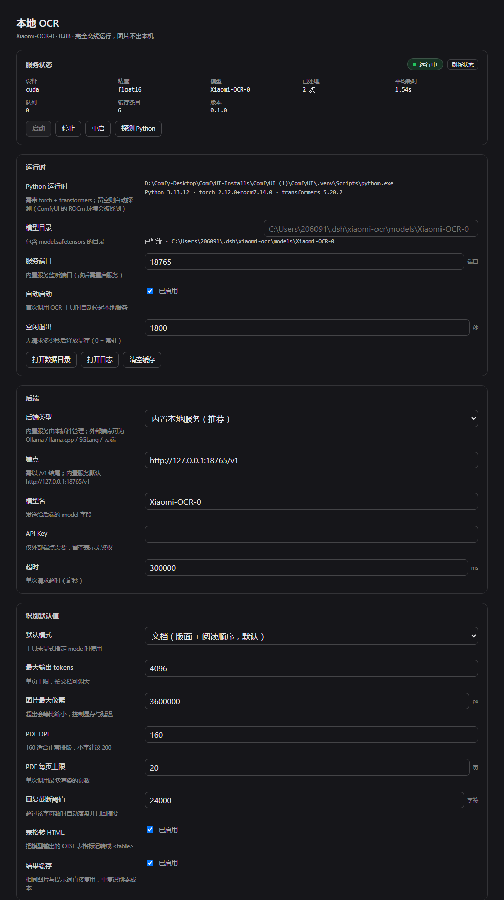

# dsh-xiaomi-ocr

本地 OCR 插件：把 **Xiaomi-OCR-0（0.8B 视觉语言模型）** 装进 DeepSeek Harness，图片不出本机。

它替代云端 OCR 的那条链路：没有上传、没有按次计费、没有网络抖动、没有“服务繁忙”，
也不受任何平台的内容审查影响。代价是本机要有 GPU 和一份约 1.7 GB 的权重 —— 一次性投入。

| 能力 | 说明 |
| --- | --- |
| 文档解析 | 版面 + 阅读顺序 → Markdown；表格 OTSL（可选转 HTML），公式 LaTeX |
| 纯文本 | 单行/多行文字抽取 |
| 表格 / 公式 | 单区域精修，输出 OTSL / LaTeX |
| KIE | 给 JSON Schema 或字段清单，返回结构化 JSON（小票、发票、证件、运单） |
| VQA | 就图片内容提问（图表、截图、手写） |
| PDF | 逐页渲染 + 逐页识别，超长结果自动落盘 |

## 工具

| 工具 | 用途 |
| --- | --- |
| `ocr_image` | 单张图片。`mode`: `document` / `text` / `table` / `formula` / `page` |
| `ocr_pdf` | PDF。`pages: "1-5,8"`、`dpi`、`maxPages`，结果按页分块 |
| `ocr_kie` | 关键信息抽取，返回 JSON |
| `ocr_vqa` | 图片问答 |
| `ocr_status` | 后端、模型、设备、队列、Python、缓存、路径一屏看完 |

示例：

```text
ocr_image path=D:\scan\invoice.png                    # 整页 → Markdown
ocr_pdf   path=D:\docs\paper.pdf pages=1-3 dpi=200    # 前 3 页，高清
ocr_kie   path=receipt.jpg schema={"total":"string","date":"string"}
ocr_vqa   path=chart.png question="哪一年增长最快？"
```

## 设置页

安装后，**设置 → 本地 OCR** 是一个独立分页（不是塞在插件列表里的配置块）：



包含：

- **服务状态**：运行中/未运行、设备、精度、平均耗时、队列、缓存条目；启动 / 停止 / 重启 / 探测 Python
- **运行时**：Python 路径（自动探测 ComfyUI 的 ROCm 环境）、模型目录、端口、自动启动、空闲退出秒数、打开数据目录 / 日志、清空缓存
- **后端**：内置本地服务 或 任意 OpenAI 兼容端点（Ollama / llama.cpp / SGLang / 云端）
- **识别默认值**：默认模式、最大 tokens、最大像素、PDF DPI / 页数上限、截断阈值、表格转 HTML、结果缓存
- **试运行**：填一张图，直接在页面里跑一次，看输出与耗时

所有字段都是 `.volatile()` 配置，改动即时生效并持久化到本 profile 的 `cordis.patch.yml`。

## 运行时要求

需要一份带 `torch` + `transformers` + `Pillow` 的 Python 3.13 解释器，以及模型权重：

```
%USERPROFILE%\.dsh\xiaomi-ocr\
├─ models\Xiaomi-OCR-0\      # model.safetensors + tokenizer + config
├─ cache\                    # 识别结果缓存（按 图片哈希|提示词|参数）
├─ logs\server.log           # 本地服务日志
├─ tmp\                      # PDF 渲染临时页
└─ pylibs\                   # 插件私有 wheel（pypdfium2）
```

插件按顺序探测解释器：设置里的 `pythonPath` → `~/.dsh/xiaomi-ocr/venv` →
本机 ComfyUI 的 `.venv`（`D:\Comfy-Desktop\ComfyUI-Installs\*\ComfyUI\.venv`）。

没有现成环境时：

```powershell
# 1) 建独立 venv（ROCm 例；NVIDIA 换 cu124 索引）
pwsh projects/xiaomi-ocr/scripts/setup-runtime.ps1 -Python "C:\Python313\python.exe"

# 2) 下模型（约 1.7 GB）
python -c "from huggingface_hub import snapshot_download as s; s('xiaomi-research/Xiaomi-OCR-0', local_dir=r'%USERPROFILE%\.dsh\xiaomi-ocr\models\Xiaomi-OCR-0', allow_patterns=['config.json','model.safetensors','tokenizer.json','tokenizer_config.json','processor_config.json','chat_template.jinja'])"
```

细节见 [docs/runtime.md](docs/runtime.md)。

## 实现

```
lib/index.js      宿主半：5 个工具 + Runtime 监管 + 结果缓存 + 设置页 RPC
lib/client.js     浏览器半：settings.section 分页（手写 lazy-CJS，无构建步骤）
runtime/server.py 本地推理服务：OpenAI 兼容 /v1/chat/completions，模型常驻显存
runtime/render_pdf.py  PDF → PNG（pypdfium2，装在插件私有目录）
```

- 服务默认端口 `18765`，只监听 `127.0.0.1`，`POST /shutdown` 可停。
- 首次工具调用会按需拉起服务（模型加载约 2–4 s）；空闲 1800 s 自动释放显存。
- 同一个 Python 进程完成解码/预处理/生成，避免 torchvision 缺少 libjpeg 的坑；
  **fp16 在 AMD ROCm 上比 bf16 快一倍**，插件按后端自动选精度。

## 实测性能（RX 6800 XT / ROCm 7.14 / fp16）

| 输入 | 输出 | 耗时 |
| --- | --- | --- |
| 收据 932×1644 | 298 tokens | 10.0 s（30.1 tok/s） |
| 论文公式页 1800×1303 | 1822 tokens | 57.1 s |
| 表格 880×420 | 124 tokens | 4.0 s（命中缓存则 <0.1 s） |
| 单页 PDF（含渲染） | 294 tokens | 10.6 s |

bf16 同样输入约 12.9 tok/s —— 慢一倍，所以默认走 fp16。

## 排查

| 现象 | 处置 |
| --- | --- |
| `未找到本地模型` | 下模型到 `~/.dsh/xiaomi-ocr/models/Xiaomi-OCR-0`，或在设置页改 `模型目录` |
| `没有找到可用的 Python 运行时` | 设置页「运行时 → Python 路径」填 `...\.venv\Scripts\python.exe`，点「探测 Python」 |
| `模型加载失败` | 看 `~/.dsh/xiaomi-ocr/logs/server.log`；显存不足时把「最大像素」降到 2.5M |
| `无法连接 OCR 后端` | 端口被占？改端口后点「重启」；或用外部端点模式 |
| 表格是 `<fcel>` 标记 | 打开「表格转 HTML」并重新识别（`refresh=true` 跳过缓存） |

## 已知限制

- OTSL → HTML 是尽力而为：合并单元格（`<lcel>/<ucel>` 跨行列）转成空 `<td>`，不做 rowspan/colspan。
- PDF 逐页串行（单卡单模型），20 页约 3 分钟；大文档建议先用 `pages` 分段。
- `page` 模式对书法/场景文字的提示词是插件自定的，不是上游原句；`document/text/table/formula` 用的都是上游原文提示词。
- Windows + ROCm 下没装 libjpeg 的 torchvision 不能直接吃图片路径，插件已改走 PIL，无需处理。

## 开发

```powershell
node tests/smoke.mjs     # 宿主半解析 + OTSL 转换 + 客户端 bundle 的 slot 注册
pnpm pack                # 产出 dsh-xiaomi-ocr-<version>.tgz（≤8 MiB）
```

装进本机 profile 用 DSH 的 `install_local_workbench`；改动代码后需要重启 Harness 才生效
（包被移动到新 generation，运行中的进程还持有旧副本）。

两条硬性契约，改动时别丢：

- `package.json` 的 `dsh.client.inject` 必须包含 `"dsh-desktop-workbenches"`，否则 Desktop 的本地安装器拒收。
- `cordis.patch.yml` 里的条目 `id`（`xiaomi-ocr`）就是设置命名空间；`lib/client.js` 的 `ENTRY_ID` 必须与之一致。

## 许可

插件代码 MIT。模型权重为 Apache-2.0（[xiaomi-research/Xiaomi-OCR-0](https://huggingface.co/xiaomi-research/Xiaomi-OCR-0)），使用与再分发请遵守其条款。
